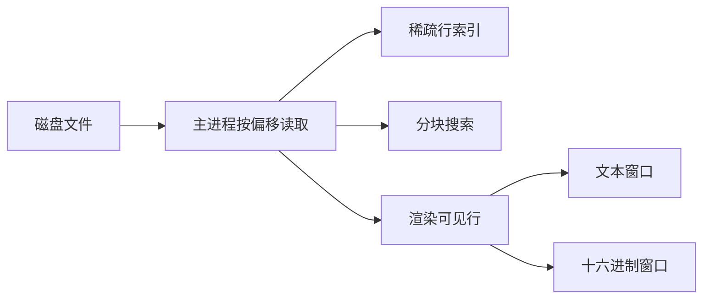

# EditLong

面向大文件的记事本式桌面编辑器：按窗口读取、不整份装进内存；支持十六进制浏览、搜索，以及截图、录屏和一组常用工具。界面为中文，基于 Electron。

当前版本：**1.3.0**（Windows x64）

## 功能一览

| 类别 | 能力 |
| --- | --- |
| 编辑 | 多标签、多窗口（标签拖出/拖回）、≤16MB 可编辑，更大只读浏览 |
| 视图 | 文本（行号）、十六进制（偏移 / hex / ASCII） |
| 查找 | 文本或十六进制字节；转到行号或 `0x` 偏移 |
| 编码 | UTF-8、GBK、GB18030、Latin-1、UTF-16 LE；识别 UTF-8 / UTF-16 BOM |
| 系统 | 右键「用 EditLong 打开」、系统「打开方式」、单实例、窗口置顶 |
| 截图 / 录屏 | 区域截图（剪贴板 + 钉住标注）、区域录屏 MP4 |
| 视频 | 可视化剪辑（裁剪 / 混音 / 转格式 / 压缩） |
| 工具箱 | 时间戳、JSON、图片批量转换、二维码、加解密、视频表单 |
| 对象存储 | OSS / COS / BOS / S3 / B2 浏览、上传下载 |
| 远程 | SSH 终端 + SFTP |
| HTTP | 简单版 Postman：发请求、看响应、保存并自定义标题 |

## 运行与打包

需要 Node.js。首次 `npm install` 会拉取 Electron 和 `ffmpeg-static`（体积较大）。

```bash
npm install
npm start
```

```bash
npm start -- D:\path\to\file.txt    # 带文件启动
node scripts/smoke.js               # 文件会话冒烟测试（不启窗口）
npm run icon                        # 生成 build/icon.ico
npm run dist                        # Windows x64 NSIS 安装包
npm run dist:dir                    # 仅解包目录，不生成安装程序
```

安装包：`dist/EditLong-Setup-1.3.0-x64.exe`。可改安装目录，会创建桌面/开始菜单快捷方式，并注册右键与打开方式。`dist/` 和 `.exe` 已 gitignore，不要提交到 GitHub。

## 界面

菜单按记事本习惯：**文件、编辑、搜索、编码、语言、设置、工具、窗口、?**。

工具栏：新建 / 打开 / 保存 / 另存为 / 关闭，剪贴板与撤销重做，查找 / 转到，文本与十六进制，工具箱、HTTP、SSH、对象存储、视频、录屏、截图、置顶，以及编码下拉框。

| 菜单 | 内容 |
| --- | --- |
| 文件 | 新建、打开（可多选）、最近文件、保存 / 另存为、关闭、关闭全部、退出 |
| 编辑 | 撤销重做、剪切复制粘贴删除、全选、大小写 |
| 搜索 | 查找、上一个 / 下一个、转到行号或 `0x` 偏移 |
| 编码 | UTF-8、GBK、GB18030、Latin-1、UTF-16 LE |
| 语言 | 状态栏标签：纯文本、C/C++、HTML、JS、JSON、Markdown、Python、XML、Batch、INI、SQL、PHP |
| 设置 | 自动换行、窗口置顶、截图快捷键、注册/取消「打开方式」与右键 |
| 工具 | 工具箱各页、视频剪辑、对象存储、SSH/SFTP、HTTP、截图、录屏 |
| 窗口 | 文本 / 二进制，最小化、最大化 |
| ? | 关于 |

状态栏：路径、行列、字节偏移、大小、语言、窗口类型、缩放百分比。

### 多标签与多窗口

- 每个打开的文件一个标签；未保存显示 `*`
- 点击切换；点 × 或中键关闭；有未保存修改时确认
- 同一路径再次打开会切到已有标签（全局只开一份）
- 主窗口关到最后一个标签后回到欢迎页；次级窗口关完最后一个标签后关闭该窗口
- **拖出**：把标签拖出当前标签栏，在鼠标位置新建编辑窗口
- **拖回**：拖到另一编辑窗口的标签栏即并入

### 右键打开 / 打开方式

安装包会注册：

- 资源管理器右键 **「用 EditLong 打开」**（任意文件）
- 系统 **「打开方式」** 中的 EditLong

也可在 **设置** 里手动注册或取消。已运行时再打开会送到现有窗口。列表未刷新时可注销重登或重启资源管理器。

## 快捷键

| 操作 | 快捷键 |
| --- | --- |
| 新建 / 打开 | Ctrl+N / Ctrl+O |
| 保存 / 另存为 | Ctrl+S / Ctrl+Shift+S |
| 关闭当前标签 | Ctrl+W |
| 切换标签 | Ctrl+Tab / Ctrl+Shift+Tab |
| 编辑区缩放 / 复位 | Ctrl+滚轮，Ctrl+= / Ctrl+-；Ctrl+0 复位 |
| 查找 / 下一个 / 上一个 | Ctrl+F / F3 / Shift+F3 |
| 转到行号或偏移 | Ctrl+G |
| 文本 / 二进制窗口 | Ctrl+1 / Ctrl+2 |
| 撤销 / 重做 | Ctrl+Z / Ctrl+Y |
| 区域截图 | Ctrl+Shift+A（可在设置里改） |
| 区域录屏 | Ctrl+Shift+R |
| 截图钉住：缩放 / 撤销 / 取消框选 | Ctrl+滚轮；Ctrl+Z；Esc |

SSH 终端：右键复制/粘贴；Ctrl+Shift+C 复制，Ctrl+Shift+V 或 Shift+Insert 粘贴。

## 编辑器

超过 16MB 只读浏览（虚拟列表）；不超过 16MB 可像记事本一样编辑、保存、另存为。查找会滚到匹配处，滚动条跟随。

大文件留在磁盘上，主进程按偏移读取当前窗口：



- 行号：每 1024 行记一个偏移（稀疏索引）
- 二进制：每行固定 16 字节
- 搜索：4MB 分块，不把整文件读进内存
- 多窗口：同一进程，标签带窗口归属；拖出/拖回只改归属，不重新打开文件

## 截图

工具栏、**工具 → 区域截图**，或 **Ctrl+Shift+A**。框选后：

1. 自动写入剪贴板，可立刻 Ctrl+V
2. 弹出置顶预览：拖动移动；画笔/文字标注；Ctrl+滚轮缩放（约 20%～800%）；保存 PNG/JPG 或再复制

快捷键存在用户数据目录 `settings.json` 的 `snipShortcut`。

## 录屏

工具栏、**工具 → 区域录屏**，或 **Ctrl+Shift+R**。先选麦克风 / 电脑音频，再框选区域，ffmpeg 输出 H.264 MP4。

- 麦克风：DirectShow
- 电脑音频：优先立体声混音；没有时可试 WASAPI 环回。Windows「声音」里需启用立体声混音，并允许应用使用麦克风

写入 `settings.json`（`recordMic`、`recordSysAudio`）。两个都关则只录画面。

## 视频剪辑

工具栏播放图标，或 **工具 → 视频剪辑**。

打开视频（可选再打开音频）→ 预览与胶片条定位 → 入点/出点或分割片段 → 裁剪 / 混音或替换音轨 / 转格式 / 压缩 → 导出。

格式：MP4、WebM、MKV、MOV、AVI，或仅音频 MP3 / WAV / AAC。裁剪可勾选尽量无损复制流。工具箱「视频」页是同一套处理的表单入口。

## 对象存储

工具栏云图标，或 **工具 → 对象存储 (OSS/COS/BOS/S3/B2)**。

- 左侧连接：OSS / COS / BOS / S3 / B2（S3 兼容）；Endpoint、Region、AK/SK；可测连接
- 浏览 Bucket「文件夹」（前缀）；拖拽或按钮上传（按扩展名写 Content-Type）；下载/另存
- 新建文件夹、删除；右键复制访问地址、重命名（复制到新路径再删旧对象）

保存在 `storage-connections.json`（含密钥，请自行保管）。主窗口的子窗口，关主窗口时一并关掉。

## 远程连接 SSH/SFTP

工具栏终端图标，或 **工具 → 远程连接 (SSH/SFTP)**。

- 左侧主机：主机、端口、用户名；密码或私钥（可选口令）；可测连接
- **终端**：远程 Shell；右键复制/粘贴
- **文件 SFTP**：浏览、上传（可拖拽）、下载、新建文件夹、重命名、删除

保存在 `ssh-connections.json`。关闭该窗口或主窗口会断开会话。

## HTTP 请求

工具栏橙色图标，或 **工具 → HTTP 请求 (Postman)**。

- 方法 GET/POST/PUT/PATCH/DELETE/HEAD/OPTIONS，URL 后点发送（Enter 亦可）
- Query、请求头、正文（无 / JSON / 文本 / form-urlencoded）
- 认证：无、Bearer、HTTP Basic；可选忽略证书错误
- 响应：状态码、耗时、大小、正文、响应头；可复制、格式化 JSON
- 左侧保存常用请求；顶部「标题」可自定义，列表里 ✎ 或双击改名

保存在 `http-requests.json`。仅 http/https；正文超过 2MB 截断。

## 快捷工具箱

工具栏箱子图标，或「工具」菜单（可直接打开某一页）。

| 页签 | 功能 |
| --- | --- |
| 时间 | Unix 时间戳（秒/毫秒）与 `YYYY-MM-DD HH:mm:ss` 互转，可选时区 |
| JSON | 校验格式化、压缩、转义/去转义、Unicode 与中文互转 |
| 图片 | 多图拖入，转 JPEG/PNG/WebP，可压缩、改尺寸后导出 |
| 二维码 | 文本/链接生成二维码，复制或保存 PNG |
| 加解密 | AES-256-GCM、DES-ECB、MD5、Base64、SHA-1/256/512 |
| 视频 | 裁剪 / 混音 / 转格式 / 压缩表单；可打开可视化窗口 |

加解密仅便民，**不要用来保护真正机密**（尤其 DES / MD5）。AES 由口令经 PBKDF2 派生，密文为 Base64。

## 版本记录

### 1.3.0

对象存储、视频剪辑、SSH/SFTP、HTTP 请求、标签拖出多窗口、二维码、窗口置顶。

### 1.2.0

多标签、单实例、右键/打开方式、截图进剪贴板与钉住窗口。

## 技术栈与目录

Electron 33（隔离渲染 + preload IPC）。依赖：`iconv-lite`、`ffmpeg-static`、`@aws-sdk/client-s3`、`ssh2`、`@xterm/xterm`、`qrcode`。

```
src/main/        窗口、菜单、多标签、工具箱、对象存储、SSH、HTTP、视频、截图、录屏、右键注册
src/renderer/    主界面、各工具窗口、截图钉住、录屏条
src/preload*.js  预加载桥
build/           图标、NSIS 脚本
scripts/         smoke.js、make-icon.js
```

许可证：MIT。
